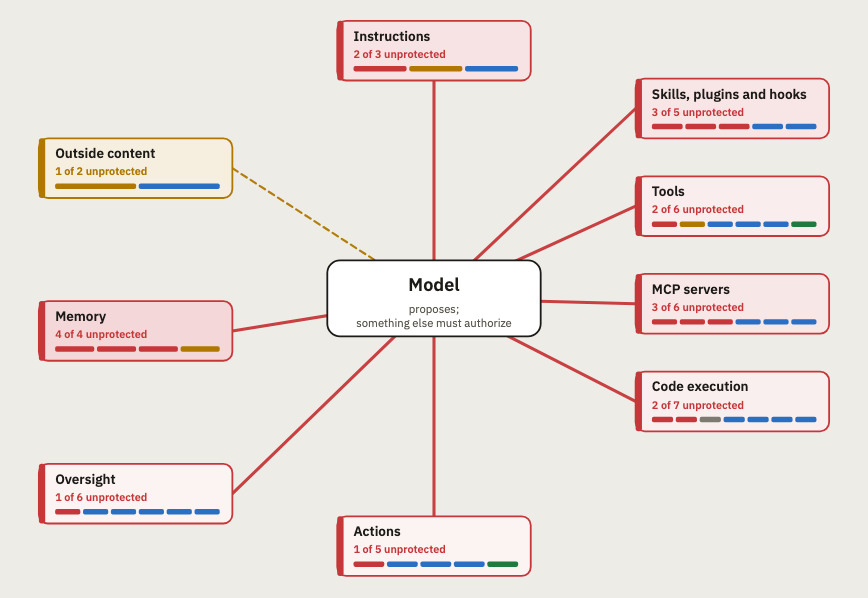

# Agent Boundary Map

**See everything your AI agent trusts, and which of those boundaries still hold when the model gets it wrong.**

**[Open the app →](https://emanherawy.github.io/agent-boundary-map/)** It runs entirely in your browser. Your answers never leave it.

## Why it exists

An AI agent depends on many things it can't fully trust: the content it reads, the tools and MCP servers it calls, the skills and packages it loads, its credentials and memory, other agents and users, and the model itself. Each can fail:

- In a demonstration, a hidden comment on a web page made an AI browser send the user's email address and one-time code to an attacker ([Brave](https://brave.com/blog/comet-prompt-injection/)).
- An MCP server, after 15 normal releases, began secretly copying every email to an outside address ([The Register](https://www.theregister.com/2025/09/29/postmark_mcp_server_code_hijacked/)).
- A skill marketplace was found hosting 341 malicious skills ([Palo Alto Networks Unit 42](https://unit42.paloaltonetworks.com/openclaw-ai-supply-chain-risk/)).
- And sometimes nothing is attacked at all: an agent deleted a company's production database during a code freeze ([Gizmodo](https://gizmodo.com/replits-ai-agent-wipes-companys-codebase-during-vibecoding-session-2000633176)).

These four come from the map's [evidence guide](docs/user-guide-evidence.md), which ties every question to a real incident, a demonstrated attack, research or a security standard.

What matters is whether something outside the model stops the action, such as a permission, a sandbox, a review or a person, or whether nothing does.

## What it is

Agent Boundary Map is a guided self-assessment for teams that build or configure an AI agent, whether on their own code or on a harness such as Claude Code, Codex, Cursor or OpenClaw. It walks you through every point where your agent trusts something. For each one, the report shows who holds the boundary (you, the harness, a service or a person), and whether it holds outside the model or only while the model behaves.

The map is built on one rule:

> **The model may propose, but something outside the model must authorize.**

"Outside the model" means something that isn't a model: code, a permission, the target system or a person. A second model checking the first helps, but the map rates it lower. And because no model is right every time, the map also asks what limits a wrong action, whether you'd notice it, and whether you can stop and undo it.

## How it works

1. **Describe your agent.** A short profile covers what runs it, who uses it, whether it can reach sensitive information, and which parts it has, such as tools, memory, MCP servers, a browser or other agents.
2. **Answer the questions that apply.** You only see the areas your agent has, up to 66 questions in all. "Don't know" is a valid answer: the report turns it into something to find out.
3. **Read the report.** It opens on a one- to two-page summary. Switch to **Full** for every detail.

Answer for the least protected route: if a control covers some routes but not others, pick the answer that fits the weakest one. Each answer gets one of six statuses: *Not protected*, *Relies on the model*, *Checked by another model*, *Partly protected*, *Reported as enforced outside the model* or *Not known*.

## What you get

### Routes

The report opens with the three ways untrusted input could get through your agent:

| Route | The question it answers |
|---|---|
| **Data out** | Can content the agent reads get it to reach sensitive information and send it somewhere? |
| **Changes to outside systems** | Can that content get it to change something in another system? |
| **Changes to code or files** | Can that content get it to change your code or files? |

Each route gets one status. The app checks them in this order and uses the first that applies:

| Status | What it means |
|---|---|
| **No route** | Something the route requires is missing, such as access to sensitive information. |
| **Interrupted** | A control reported as enforced outside the model blocks one of its steps. |
| **Incomplete** | One or more of its steps are unanswered. |
| **Possible route** | Every step is answered, but one or more depend on answers marked *Not known*. |
| **Open route** | Every step the route requires is open. |

### Summary and full report

- **Summary** (1–2 pages): the verdict, the routes, numbered main findings (what's wrong or not known), up to three top actions (what to do first) and the boundary map.
- **Full report:** every finding with why it matters, what to do, who likely owns the fix and the answers behind it, plus other gaps by area, unanswered questions and anything skipped as not applicable.

Download either one as PDF or Markdown; the buttons follow the view you're on. **Copy summary** puts the summary on your clipboard as Markdown, ready for a ticket or a chat.

### How top actions are chosen

The report suggests up to three actions, so you know where to start. It picks them in three steps:

1. **It ranks every finding** by these questions, in this order:
   1. Is it a step on an open route, or on a possible or incomplete one, or does it make a route easier?
   2. Can it allow unauthorized action or access?
   3. Can the agent reach sensitive information?
   4. How exposed is the agent: does it read outside content, or serve several tenants?
   5. How weak is the control?
2. **It takes one action from each finding, top down:** that finding's main recommended fix. One action per finding means the three actions address three different problems.
3. **It stops at three, and never adds filler.** Findings with no fix are skipped, so if fewer than three findings have one, you'll see fewer actions.

The screen, the summary and the full report all use this same selection, so they always list the same actions.

### Example reports

Five built-in examples open from the start page, from a single-user coding agent to a well-controlled agent with no open routes. They're illustrative, not assessments of real deployments, and opening one doesn't touch your own answers.

## What it covers

13 areas and 66 questions. You only see the areas your agent has.

| Area | Questions | What it checks |
|---|---|---|
| Instructions | 4 | What the agent obeys, where its rules live, and whether anything can change or override them, including prompt injection |
| Outside content | 2 | Whether content the agent reads can make it act, and whether data can leave to places it shouldn't |
| Memory | 4 | What gets saved, whether the agent can change it, whether it's kept apart per project, and whether sensitive data ends up there |
| Knowledge sources | 2 | Documents and indexes the agent retrieves from: what each user can get, and who can add content |
| Users | 5 | Who is asking, what they may access, and what keeps users apart, including misuse by authorized users |
| Tools | 6 | Whether the tool set can change, who can read the tools' credentials, and whether tool results and arguments are trusted |
| MCP servers | 6 | Who made them, what can connect, whether they can change, and what they can reach |
| Skills, plugins and hooks | 6 | What loads into the agent: instructions, scripts, hooks and bundled components |
| Code execution | 7 | Where code runs, what it can reach, install and read, and whether anything carries over between tasks |
| Browser | 3 | What the browser carries, what gates its actions, and who else can drive it |
| Actions | 8 | What the agent changes, and what decides, limits and records each change, including retries, scheduled tasks and agreements made on your behalf |
| Other agents | 4 | Requests from other agents, work handed to them, and the results that come back |
| Oversight | 9 | Whether you can reconstruct, stop, revoke, undo and get alerted, and whether the model or the agent's software can change without review |

## Boundaries it only partly covers

We compared the map with published models of agent trust boundaries. It covers most of them. Four are only partly covered so far.

### 1. What the agent shows people

- **In the literature:** "Response rendering" in [Google's Approach for Secure AI Agents](https://services.google.com/fh/files/misc/googles_approach_for_secure_ai_agents.pdf) (Google, 2025), and "user interfaces versus the agent" in [Alqithami (2026)](https://arxiv.org/abs/2601.04583).
- **Covered today:** data leaking out through links or images in a reply (C2), and who can see a reply (U5).
- **Not yet covered:** whether your app sanitizes the agent's replies before displaying them, so a reply can't run code in the page; and whether people can trust what the agent shows them, such as a fake security alert or an approval screen the agent wrote itself.

### 2. What the agent sees beyond text

- **In the literature:** "Input, perception and personalization" in [Google's paper](https://services.google.com/fh/files/misc/googles_approach_for_secure_ai_agents.pdf), where input can be text, images or audio, and the "system-environment" boundary in [Jing et al. (2026)](https://arxiv.org/abs/2607.12406), which includes web pages and "interface elements".
- **Covered today:** everything the agent reads (Outside content), and agents that drive a browser (Browser).
- **Not yet covered:** agents that operate a whole computer, reading the screen and clicking, where anything on screen can steer them.

### 3. The model itself

- **In the literature:** the "Model Boundary" in [Dev T Y and Nath (2026)](https://arxiv.org/abs/2609.16694), covering poisoned training data and malicious model updates.
- **Covered today:** what you send to the model provider (O6), and whether the model can change without your review (O7).
- **Not yet covered:** where the model comes from and whether anyone has tampered with it, for example model files you download and run yourself, or the data it was fine-tuned on.

### 4. Agents that cross organizations

- **In the literature:** the OpenID Foundation's [threat model for cross-boundary AI agents](https://openid.net/oidf-publishes-threat-model-for-cross-boundary-ai-agents/) (2026), where an agent hosted by one provider calls tools or services hosted by another. As the foundation puts it: "Each side has its own rules for identity, trust, and permissions."
- **Covered today:** requests from other agents and work handed to them (G1, G2), and each user's access (U2).
- **Not yet covered:** agents that act across companies or providers, where identity and permissions must carry over safely from one side to the other.

Spot a boundary we've missed? [Open an issue](https://github.com/EmanHerawy/agent-boundary-map/issues).

## Why these questions

Every question is tied to public evidence: a real incident, a demonstrated attack, research or a security standard.

- [Why these questions are here](docs/user-guide-evidence.md): a readable, question-by-question walkthrough with links.
- [Evidence register](docs/evidence.md): every source, its type and how it relates to the question.

58 of the 66 questions have direct public evidence. The other 8 rest on established security principles, and we list them openly. A source shows that a risk is real, not that your agent has it.

## Privacy

- Your answers stay in your browser's local storage.
- The app makes no network requests. Its Content-Security-Policy blocks connections (`connect-src 'none'`), and the fonts and PDF library are bundled in.
- Downloads are generated locally. Nothing is uploaded.
- Following a link to the evidence docs opens GitHub in a new tab.

## What it isn't

- **Not a certification or an audit.** Your answers are self-reported. "Reported as enforced outside the model" means *as you reported it*, not verified.
- **Not proof of an attack.** A route shows what your answers allow, not that an attack happened or would succeed.
- **Not a scanner.** It never connects to or inspects your agent.
- **Not a content-safety review.** It looks at what your agent can do and who authorizes it, not at what the model says. Harmful output, hallucination and bias are out of scope.

## Editing the app

The whole app is one file, `index.html`, with the fonts and jsPDF bundled inside it. There's no build step: edit the file and open it in a browser.

## Contributing

- **Have a better source** for a question, or one for the eight without direct evidence? [Open an issue](https://github.com/EmanHerawy/agent-boundary-map/issues) with the link and the question ID.
- **Found a security problem in the app**, such as a way it could send data out? Please report it privately: see [SECURITY.md](SECURITY.md).

## Credits

This project was inspired by **Aakash Ahuja**'s article [AI Agent Architecture: The Trust Boundary Model](https://www.aakashx.com/blog/agent-trust-boundary-model-ai-agent-architecture/) (aakashx, May 2026).

## License

[Apache 2.0](LICENSE). The bundled fonts and jsPDF keep their own licenses: see [NOTICE](NOTICE).
